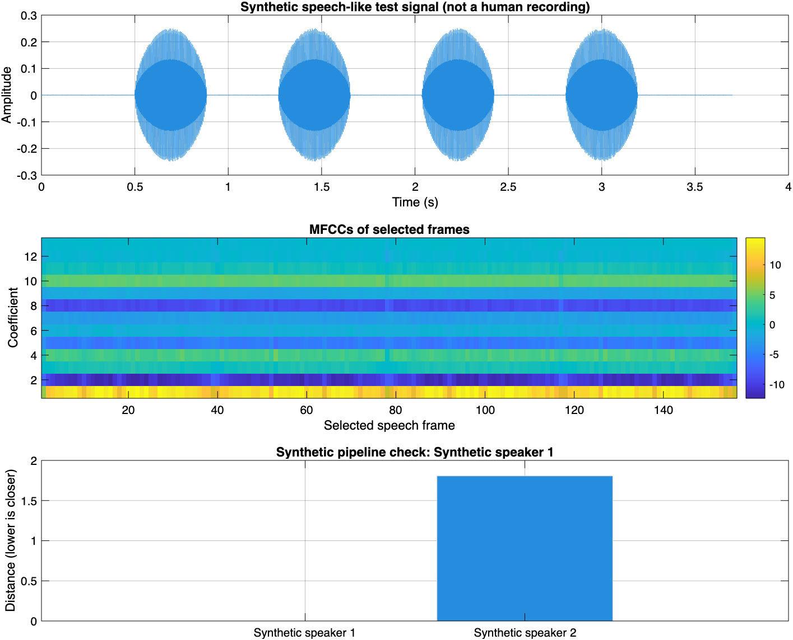

# Speaker Identification Using Signals and Systems in MATLAB

A Signals and Systems mini-project that identifies **which enrolled person is speaking** from a short recording. The implementation applies discrete-time signal operations, LTI filtering, and Fourier analysis, followed by MFCC feature extraction and minimum-distance classification.

Each person enrolls five recordings of the same phrase. A new recording is compared with the enrolled speaker profiles, and the selected person's name is displayed. This is a **text-dependent, closed-set** system: the phrase should remain the same, and the candidate identities are the enrolled people.

## Course Alignment

The explanation follows the unit sequence and course outcomes of **Signals and Systems, 702EX0C010, academic year 2026–27**. The course policy specifies topics rather than a particular equation notation; the formulas below use conventional signals and systems notation.

| Syllabus unit | Course outcome | Connection to the implementation |
|---|---|---|
| Unit 1: Introduction to Signals and Systems | CO1 | Discrete-time speech, signal operations, waveform representation, and system classification |
| Unit 2: Linear Time Invariant System | CO2 | FIR filtering, impulse response, convolution sum, and cascade connections |
| Unit 3: Fourier Series Representation of Periodic Signals | CO3 | Conceptual connection through frequency components; Fourier-series coefficients are not explicitly computed |
| Unit 4: Fourier Transform | CO4 | Main transform connection: spectra, frequency-domain multiplication, and inverse transformation, implemented using the DFT/FFT |
| Unit 5: Laplace Transform | CO4 | Not used in the current implementation |
| Unit 6: Z-transform | CO5 | Analytical interpretation of the pre-emphasis difference equation; no explicit Z-transform computation |

MFCCs, mel-scale analysis, the DCT, and speaker classification extend the listed syllabus to a speech-processing application. They are described separately after the syllabus-based explanation.

## Running the Project

### Requirements

- MATLAB with standard numerical operations, audio I/O, and plotting. Automated checks were run in MATLAB R2026a.
- No additional MATLAB toolboxes are required.
- A microphone with recording permission for live operation.
- At least two different people, each providing five enrollment recordings.

### Enroll speakers

1. Make the repository folder the MATLAB Current Folder.
2. Run `train_my_voice.m` and enter a speaker's name.
3. Click **Record** for each example, remain quiet initially, and speak after the visible **SPEAK NOW** cue:

   > This is my voice for identification.

4. Repeat the enrollment script for every additional person.

Each recording includes approximately 0.5 seconds of background followed by a four-second speaking interval. Complete the phrase within that interval and use a consistent microphone position. An insufficient-speech recording is retried. Cancelling before enrollment finishes retains existing profiles.

Enrollment accepts any display name. Re-entering an existing name, ignoring letter case, offers to replace that person's enrollment. Numeric recording folders keep display names separate from file paths.

### Identify a speaker

Run `run_demo.m` and choose **Microphone** or **WAV file**. For microphone input, read the same phrase after the recording cue. For file input, select a new 16 kHz WAV recording of that phrase with at least 0.25 seconds of initial background audio.

The result appears in a dialog and in the Command Window. A figure displays the recorded waveform, MFCCs, and distances to enrolled profiles. Use a fresh test recording rather than an enrollment file.

If the two closest scores are similar, the result is **Uncertain match**. This is an ambiguity check, not reliable rejection of an unregistered person.

## Notation

| Symbol | Meaning |
|---|---|
| $x(t)$ | Continuous-time microphone signal |
| $x[n]$ | Sampled speech sequence |
| $T_s$, $f_s$ | Sampling interval and sampling frequency, with $T_s=1/f_s$ |
| $h[n]$ | Discrete-time impulse response |
| $\Omega$ | Continuous-time angular frequency in rad/s |
| $\omega$ | Discrete-time angular frequency in rad/sample |
| $k$ | DFT frequency-bin index |
| $m$, $r$ | Frame index and sample index within a frame |
| $N$, $M$ | Full-record DFT length and frame DFT length, respectively |

Equations use zero-based sequence indices; MATLAB arrays use one-based indices.

## Unit 1: Introduction to Signals and Systems

### Speech as a discrete-time signal

The microphone and audio interface provide samples of an acoustic waveform:

$$
x[n]=x(nT_s),\qquad f_s=16000\ \text{Hz},\qquad T_s=62.5\ \mu\text{s}.
$$

The recorded sequence is real-valued, finite in duration, and generally nonperiodic. Live acquisition uses 16-bit samples. At this sample rate, the Nyquist frequency is 8 kHz; the recording hardware must control frequencies above that limit before sampling. The MATLAB program rejects other sample rates rather than treating them as 16 kHz recordings.

For a finite recording of $N_x$ samples, the discrete-time energy and finite-record mean-square value are:

$$
E_x=\sum_{n=0}^{N_x-1}|x[n]|^2,\qquad P_{N_x}=\frac{1}{N_x}\sum_{n=0}^{N_x-1}|x[n]|^2.
$$

The program uses local mean-square values for frame selection. This finite-window measurement should not be confused with classifying a finite-duration recording as an infinite-duration power signal.

### Signal operations and system classification

Stereo channels are averaged, and the recording's mean is removed:

$$
x_0[n]=x[n]-\frac{1}{N_x}\sum_{r=0}^{N_x-1}x[r].
$$

These operations connect to amplitude scaling, addition, and subtraction. The filter stages are linear for their fixed coefficients. Logarithmic compression, data-dependent frame selection, and classification make the complete identification pipeline nonlinear and adaptive rather than one LTI system.

**Code connection:** acquisition in `record_voice.m`; preprocessing and frame measurements in `sound_pattern.m`; waveform plotting in `run_demo.m`.

## Unit 2: Linear Time Invariant System

### Impulse response and convolution sum

For a discrete-time LTI system, the output is the convolution of the input and impulse response:

$$
y[n]=x[n]*h[n]=\sum_{k=-\infty}^{\infty}x[k]h[n-k].
$$

A direct example in this project is pre-emphasis. After frequency selection produces $y[n]$, the program applies:

$$
v[n]=y[n]-0.97y[n-1].
$$

The filter has impulse response:

$$
h_p[n]=\delta[n]-0.97\delta[n-1],
$$

so its output is $v[n]=y[n]*h_p[n]$. MATLAB implements this operation using `filter([1 -0.97], 1, filteredSound)`.

This is a causal, first-order FIR filter with zero initial state. Its absolute impulse-response sum is $1+0.97=1.97$, which satisfies the BIBO-stability condition. It reduces the dominance of low-frequency components relative to higher-frequency components before spectral feature extraction.

### Interconnection of systems

The preprocessing stages are connected in cascade: mean removal, frequency selection, and pre-emphasis. The resulting samples then enter windowing and feature extraction. The convolution sum describes the FIR operation directly. The full-record DFT mask uses circular convolution, as explained under Unit 4; it should not be presented as an implementation of the continuous-time convolution integral.

**Code connection:** `sound_pattern.m`.

## Unit 3: Fourier Series Representation of Periodic Signals

Fourier series express a periodic signal in terms of harmonically related components. A short voiced speech interval may contain approximately periodic excitation, which provides a conceptual link to this unit.

However, the recorded phrase is generally nonperiodic. The program does not assume it is a continuous-time periodic signal, calculate its exponential Fourier-series coefficients, or explicitly plot a Fourier-series magnitude and phase spectrum. Its implemented transform operations belong to finite-length discrete Fourier analysis.

**Coverage:** conceptual connection; not a directly implemented Fourier-series experiment.

## Unit 4: Fourier Transform

### Fourier representation and the implemented DFT

The continuous-time Fourier transform pair studied in the syllabus is conventionally written as:

$$
X(j\Omega)=\int_{-\infty}^{\infty}x(t)e^{-j\Omega t}\,dt,
$$

$$
x(t)=\frac{1}{2\pi}\int_{-\infty}^{\infty}X(j\Omega)e^{j\Omega t}\,d\Omega.
$$

This project processes a sampled, finite recording. It therefore uses the DFT and inverse DFT as computational counterparts, rather than evaluating those continuous-time integrals:

$$
X[k]=\sum_{n=0}^{N-1}x_0[n]e^{-j2\pi kn/N},\qquad 0\le k<N,
$$

$$
x_0[n]=\frac{1}{N}\sum_{k=0}^{N-1}X[k]e^{j2\pi kn/N}.
$$

Here, $x_0[n]$ is zero-padded to the transform length $N$. MATLAB's `fft` efficiently computes the DFT, while `ifft` computes the inverse. The frequency samples correspond to $\omega_k=2\pi k/N$, or $f_k=kf_s/N$ before interpreting the negative-frequency bins.

### Frequency-domain system analysis

For LTI frequency-domain analysis, filtering is expressed as spectral multiplication. In the implemented finite-record form:

$$
Y[k]=H[k]X[k],\qquad y[n]=\operatorname{IDFT}_N\{Y[k]\}.
$$

The mask $H[k]$ is one in the retained 80–7600 Hz band and its negative-frequency counterpart, and zero elsewhere. Keeping both parts preserves the conjugate symmetry of real audio.

If $h_N[n]=\operatorname{IDFT}_N\{H[k]\}$, the DFT convolution property gives:

$$
y[n]=\sum_{r=0}^{N-1}x_0[r]h_N[(n-r)\bmod N].
$$

This is **circular convolution** over the padded record. The inverse-transformed result is truncated to the original recording length. Abrupt spectral cutoffs may introduce ringing and boundary effects. This offline operation suppresses out-of-band components; it does not remove noise that overlaps the retained speech frequencies.

### Short-time frequency analysis

Speech varies over a phrase. The program therefore measures filtered audio in frames of $L=400$ samples (25 ms), advanced by $R=160$ samples (10 ms). The frame mean-square value is:

$$
P_m=\frac{1}{L}\sum_{r=0}^{L-1}|y[mR+r]|^2.
$$

Let $P_b$ be the mean-square background estimate from the initial 0.25 seconds. Selected frames satisfy:

$$
P_m>\max\left(4P_b,\;0.01\max_j P_j,\;10^{-8}\right).
$$

At least 0.5 seconds of activity, estimated as the selected-frame count multiplied by the hop duration, is required. This is an energy gate, not a guarantee that a signal contains speech.

The pre-emphasized samples in each selected frame are multiplied by a Hamming window:

$$
w[r]=0.54-0.46\cos\left(\frac{2\pi r}{L-1}\right),\qquad 0\le r<L.
$$

Windowing reduces spectral leakage relative to rectangular truncation, at the cost of a wider main lobe. A frame DFT with $M=512$ points is then computed:

$$
V_m[k]=\sum_{r=0}^{L-1}v[mR+r]w[r]e^{-j2\pi kr/M}.
$$

The feature extractor uses $|V_m[k]|^2/M$ for its spectral power measurements. Its bin spacing is $f_s/M=31.25$ Hz. Padding a 400-sample frame to 512 points gives a denser frequency grid, not greater resolving power than the frame duration and window permit.

**Code connection:** `sound_pattern.m`. Short-time framing and Hamming windowing support the Fourier analysis but are application details beyond the syllabus's explicitly listed transform topics.

## Unit 5: Laplace Transform

The implementation does not calculate Laplace transforms, regions of convergence in the Laplace domain, inverse Laplace transforms, or solutions of continuous-time differential equations. This unit is not claimed as an implemented part of the project.

## Unit 6: Z-transform

The Z-transform provides an analytical description of the pre-emphasis difference equation. With zero initial conditions:

$$
v[n]=y[n]-0.97y[n-1]
$$

becomes:

$$
V(z)=Y(z)-0.97z^{-1}Y(z).
$$

Therefore, its transfer function is:

$$
H_p(z)=\frac{V(z)}{Y(z)}=1-0.97z^{-1}.
$$

On the unit circle, the corresponding frequency response is $H_p(e^{j\omega})=1-0.97e^{-j\omega}$. This connects a discrete-time difference equation to its system function and frequency response.

The code realizes the filter directly. It does not call a symbolic Z-transform routine, calculate an inverse Z-transform, or generate ROC or pole-zero plots. This is a theoretical interpretation of an implemented filter, rather than a complete Z-transform laboratory exercise.

**Code connection:** the pre-emphasis operation in `sound_pattern.m`.

## Application Extension: From Spectra to Speaker Identity

Fourier analysis provides frequency information, but a spectrum alone does not supply a person's name. The following feature extraction and classification stages complete the application.

### MFCC feature extraction

The nonnegative-frequency frame spectrum is measured through 26 triangular filters between 80 and 7600 Hz. Their positions are spaced using:

$$
\operatorname{mel}(f)=2595\log_{10}\left(1+\frac{f}{700}\right).
$$

For filter index $b=0,\ldots,25$ and weights $B_b[k]$, the band measurement and compressed value are:

$$
E_b[m]=\sum_{k=0}^{M/2}B_b[k]\frac{|V_m[k]|^2}{M},\qquad \ell_b[m]=\ln\left(\max(E_b[m],10^{-12})\right).
$$

A discrete cosine transform produces the retained coefficients:

$$
c_q[m]=\sqrt{\frac{2}{26}}\sum_{b=0}^{25}\ell_b[m]\cos\left(\frac{\pi q(b+1/2)}{26}\right),\qquad q=1,\ldots,13.
$$

Coefficient zero is omitted to reduce sensitivity to uniform changes in log-band level. The coefficients summarize spectral-envelope characteristics, which reflect vocal tract properties as well as the phrase, microphone, and environment. They do not perfectly isolate identity from those other influences.

MFCCs and the DCT are application extensions, not Fourier-series coefficients or explicitly listed syllabus units. See the [MathWorks speaker identification example](https://www.mathworks.com/help/audio/ug/speaker-identification-using-pitch-and-mfcc.html) and [MFCC documentation](https://www.mathworks.com/help/audio/ref/mfcc.html) for background. This project implements its own feature extractor without the toolbox `mfcc` function.

### Statistical profiles and speaker matching

Each utterance is represented by the mean and sample standard deviation of its 13 coefficients:

$$
\mathbf{p}=[\mu_1,\ldots,\mu_{13},\sigma_1,\ldots,\sigma_{13}]^T.
$$

For speaker $s$, the centroid $\mathbf{c}_s$ is the average of five enrollment descriptors. Each coordinate is scaled by its standard deviation across all enrollment descriptors, with a minimum scale of 0.5. Let that scale be $a_i$. The class distance is:

$$
d_s=\frac{1}{26}\sum_{i=1}^{26}\left(\frac{p_i-c_{s,i}}{a_i}\right)^2,\qquad \hat{s}=\arg\min_s d_s.
$$

Test data are not used to estimate the scales. For the smallest two scores, $d_{(1)}$ and $d_{(2)}$, ambiguity is measured by:

$$
g=\frac{d_{(2)}-d_{(1)}}{\max(d_{(2)},\varepsilon)}.
$$

A value below 0.10 produces **Uncertain match**. These scores are distances and a heuristic separation measure, not identity probabilities. An unregistered person's voice can still be assigned to an enrolled person.

**Code connection:** features in `sound_pattern.m`, enrollment in `train_my_voice.m`, and classification in `identify_speaker.m`.

## Validation and Example Figure



*Figure 1. MATLAB output for a generated speech-like signal and two synthetic profiles. It validates pipeline operation and visualization, not identification accuracy on human speakers.*

Run the automated checks from the project folder:

```matlab
addpath('tests');
test_speaker_identification;
```

The checks cover separate synthetic test realizations, gain invariance, mono/row/stereo inputs, WAV import, silence, stationary noise, insufficient audio, unsupported sample rates, invalid profiles, and tied scores. To regenerate the figure:

```matlab
test_speaker_identification(fullfile(pwd, 'docs', 'images'));
```

Human identification accuracy has not been measured. Evaluate fresh recordings from multiple people in separate enrollment and test sessions, and report a confusion matrix and per-speaker results before claiming accuracy.

## Repository Structure

| Path | Purpose |
|---|---|
| `train_my_voice.m` | Named enrollment with five recordings per speaker |
| `run_demo.m` | Microphone or file input, result dialog, and plots |
| `record_voice.m` | Shared recording procedure with visible cues |
| `sound_pattern.m` | Signal processing and MFCC feature extraction |
| `identify_speaker.m` | Profile validation and minimum-distance classification |
| `tests/test_speaker_identification.m` | Automated pipeline and input-validation checks |
| `speaker_profiles.mat` | Local names and feature templates; ignored by Git |
| `speaker_recordings/` | Local enrollment recordings; ignored by Git |
| `docs/images/speaker_validation.png` | Synthetic validation figure |

The `demo_audio/` and `my_recordings/` directories and older result images are legacy assets without verified multi-speaker labels. They are not loaded by this system. Enroll each participant afresh.

## Limitations

- Use the same phrase and similar recording conditions for enrollment and identification.
- Spectral features also vary with phonetic content, room acoustics, and microphones.
- Statistical averaging discards detailed temporal order and may confuse similar voices.
- The energy gate can admit noise, and the band mask cannot remove all interference.
- There is no calibrated rejection threshold for unregistered people, replay detection, or spoofing resistance.
- The project is an educational speaker-identification baseline, not an authentication mechanism.
- Speaker names, recordings, and feature templates remain local and are excluded from version control.
