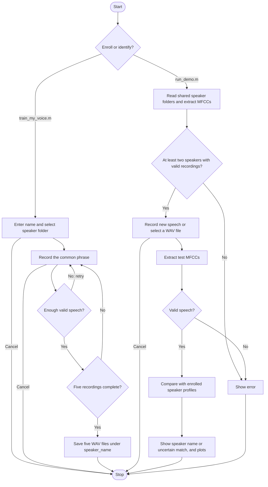

# Speaker Identification in MATLAB

Identify an enrolled speaker from a short recording of the same phrase. The project has **four MATLAB files** and a folder of shared audio samples.

## How It Works



Profiles are calculated in memory from the WAV files every time you run identification. No metadata files or profile database are required. Names come from the speaker folder names.

## Files

| File | Purpose |
|---|---|
| `train_my_voice.m` | Record and save five samples for a named speaker |
| `run_demo.m` | Load speakers, identify new speech, and display results |
| `record_voice.m` | Shared microphone recording with quiet/speak cues |
| `sound_pattern.m` | Filter audio and extract MFCC features |

The `speaker_recordings/` folder contains the actual enrollment data:

```text
speaker_recordings/
  speaker_arnav/
    sample_001.wav ... sample_005.wav
  speaker_sarvesh/
    sample_001.wav ... sample_005.wav
```

## Use

Open the project folder in MATLAB. No additional toolboxes are required.

**To identify a speaker:** run `run_demo.m`, choose Microphone or WAV file, and use a new recording of:

> This is my voice for identification.

The result appears in a dialog and the Command Window. The figure displays the waveform, MFCCs, and matching distances. Lower distances indicate a closer match. Similar scores produce **Uncertain match**.

**To add a speaker:** run `train_my_voice.m`, enter their name, and record five examples. Stay quiet until **SPEAK NOW**, then finish the phrase within four seconds. Poor recordings are retried. Cancelling an unfinished enrollment keeps the existing recordings. Replacing an existing speaker folder requires confirmation.

Names are converted to lowercase folder names: `Arnav Deshpande` becomes `speaker_arnav_deshpande`. Spaces and punctuation become underscores, so use distinct names that produce different folders.

**To share recordings:** commit and push the person's entire speaker folder. Your collaborator pulls the changes and runs `run_demo.m`; the new speaker is included automatically. MATLAB does not push files to GitHub itself.

Use 16 kHz WAV files with at least 0.25 seconds of background audio at the beginning. At least two enrolled speakers are needed. The same phrase and similar microphone conditions should be used for enrollment and testing.

## Signal Processing

1. Convert audio to mono, remove its mean, and retain 80–7600 Hz using an FFT mask and inverse FFT.
2. Select speech using frame power over 25 ms frames with a 10 ms hop.
3. Apply pre-emphasis, a Hamming window, a 512-point FFT, 26 mel filters, a logarithm, and a DCT.
4. Keep 13 MFCCs, excluding coefficient zero. Their means and standard deviations form a 26-value descriptor.
5. Average each person's five descriptors and select the nearest speaker using distances scaled by enrollment variation.

The main Signals and Systems connections are discrete-time operations (Unit 1), LTI filtering and convolution (Unit 2), and Fourier analysis (Unit 4). The pre-emphasis difference equation also has a Z-transform interpretation (Unit 6):

$$
y[n]=x[n]-0.97x[n-1],\qquad H(z)=1-0.97z^{-1}.
$$

The finite-record Fourier operations use:

$$
X[k]=\sum_{n=0}^{N-1}x[n]e^{-j2\pi kn/N},\qquad Y[k]=H[k]X[k].
$$

Spectral multiplication corresponds to circular convolution at the DFT length. The MFCC descriptor and matching score are:

$$
\mathbf{p}=[\mu_1,\ldots,\mu_{13},\sigma_1,\ldots,\sigma_{13}]^T,\qquad
 d_s=\frac{1}{26}\sum_{i=1}^{26}\left(\frac{p_i-c_{s,i}}{a_i}\right)^2.
$$

Here, $c_s$ is a speaker's mean descriptor and $a_i$ is the enrollment standard deviation for that coordinate, floored at 0.5. A relative separation below 0.10 between the best two scores produces an uncertain result. MFCCs and classification extend the listed syllabus; Fourier-series and Laplace-transform calculations are not implemented.

This is an educational, closed-set speaker classifier. Human accuracy has not been established, and an unregistered person may be matched to an enrolled speaker. Use fresh test recordings rather than treating enrollment matches as accuracy measurements.
