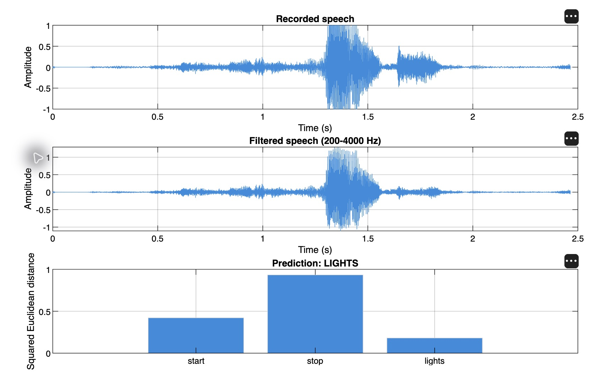
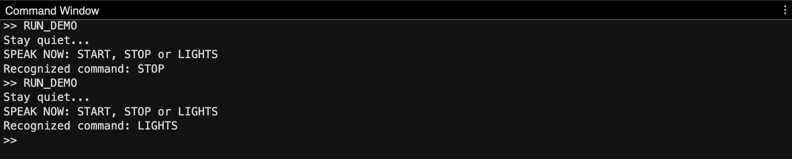

# Voice Command Recognition Using Spectral Features in MATLAB

An academic mini-project in signals and systems that implements isolated-word recognition for **START**, **STOP**, and **LIGHTS**. The system combines frequency-domain filtering, background-power estimation, and reference-template matching to demonstrate a compact speech signal processing pipeline.

## Objective

To acquire a short speech recording, reduce frequency components outside the selected speech band, extract a normalized spectral descriptor, and classify the recording against a small vocabulary. The implementation supports microphone input and a reproducible demonstration using supplied synthetic audio.

## Methodology

1. **Acquisition:** Record mono audio at 16 kHz, or load a supplied test clip. Microphone acquisition uses 16-bit samples and approximately 2.5 seconds of recording, including an initial quiet interval.
2. **Speech activity check:** Compare the recording's root-mean-square amplitude with the first 0.25 seconds of background audio. Reject recordings with insufficient additional energy.
3. **Frequency filtering:** Apply an FFT-domain mask retaining 200–4000 Hz and the corresponding negative-frequency bins. Transform the masked spectrum back to the time domain for visualization.
4. **Feature extraction:** Partition the positive-frequency speech band into 24 equal bands. Subtract estimated background power from each band's mean power, apply a logarithm with a numerical floor, remove the feature mean, and normalize to unit length.
5. **Template matching:** Compute squared Euclidean distances between the input descriptor and three reference recordings per command. Retain the smallest distance for each class.
6. **Decision:** Accept the nearest class when its distance is at most 0.30 and its relative separation from the second-best class is at least 0.15. Otherwise, display **PLEASE REPEAT**.

For input descriptor **p** and reference descriptor **t**, the matching distance is:

$$d(\mathbf{p},\mathbf{t}) = \sum_{b=1}^{24}(p_b-t_b)^2$$

The relative separation is $(d_2-d_1)/\max(d_2,\varepsilon)$, where $d_1$ and $d_2$ are the two smallest class distances. These values are distances and decision heuristics, rather than calibrated probabilities.

## Requirements

- MATLAB with audio recording, WAV file I/O, FFT, and plotting support; example outputs were observed in **MATLAB R2026a**.
- No additional MATLAB toolboxes are required by the implementation.
- A working microphone and operating-system microphone permission for live recognition.

## Execution

Open the repository folder in MATLAB and set it as the **Current Folder**.

### Supplied audio demonstration

In `run_demo.m`, set:

```matlab
useMicrophone = false;
testWord = 'start';   % 'start', 'stop', or 'lights'
```

Run `run_demo.m`. The script loads the selected synthetic test clip and adds reproducible 120 Hz hum and random noise at a whole-recording input SNR of 10 dB. References are read from `demo_audio/`.

### Microphone recognition

The checked-in script currently uses `useMicrophone = true`.

1. Run `train_my_voice.m` and record three examples of each prompted command. Press Enter in the Command Window when ready for each example.
2. Remain quiet during the initial interval and speak after **SPEAK NOW**.
3. Run `run_demo.m` with `useMicrophone = true` and click **Record** in the readiness dialog.
4. Speak one trained command after **SPEAK NOW: START, STOP or LIGHTS** appears in the Command Window.

Use a consistent microphone position, speaking distance, and pronunciation. Training again overwrites the nine local reference recordings. The `my_recordings/` directory is excluded from version control.

## Example Results

The screenshots below document example microphone runs in MATLAB. The figure was redrawn from the existing run's recorded signal, filtered signal, and matching scores with presentation formatting; recognition values were retained.



*Figure 1. Recorded and filtered waveforms with squared Euclidean matching distances. LIGHTS has the smallest class distance and is the accepted prediction in this example.*



*Figure 2. Command Window output from example runs reporting STOP and LIGHTS. The script also presents the result in a separate Recognition result dialog.*

An independent numerical check of the supplied synthetic clips matched all three commands with the specified added noise. The screenshots illustrate execution and output presentation; they do not establish accuracy, generalization across speakers, or performance on unknown commands. No held-out human-speaker benchmark or aggregate accuracy estimate is reported.

## Repository Structure

| Path | Description |
|---|---|
| `run_demo.m` | Audio acquisition, speech activity check, matching, result dialog, and plots |
| `sound_pattern.m` | FFT-domain filtering and 24-band spectral descriptor extraction |
| `train_my_voice.m` | Acquisition of three reference recordings per command |
| `demo_audio/` | Supplied synthetic reference and test WAV files |
| `docs/images/` | Screenshots used in this README |
| `my_recordings/` | Local microphone references; ignored by Git |

## Limitations

- The first 0.25 seconds of each recording must contain background audio only.
- Filtering removes components outside 200–4000 Hz; overlapping speech and in-band noise remain. An abrupt frequency mask may introduce ringing.
- Background-power subtraction operates on recognition features. The displayed filtered waveform is obtained from the frequency mask alone.
- Averaging spectral power over the full recording discards temporal order, limiting discrimination between acoustically similar commands.
- Recognition depends on the reference speaker and recording conditions. Unknown words or sudden noise can still be accepted incorrectly.
- Decision thresholds are initial demonstration settings and require independent development data for tuning.

The project performs isolated-command classification. General speech transcription, speaker identification, and application control are outside its implemented scope.
