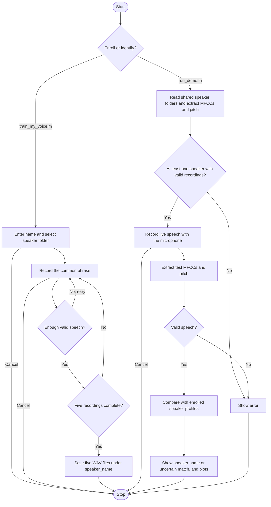
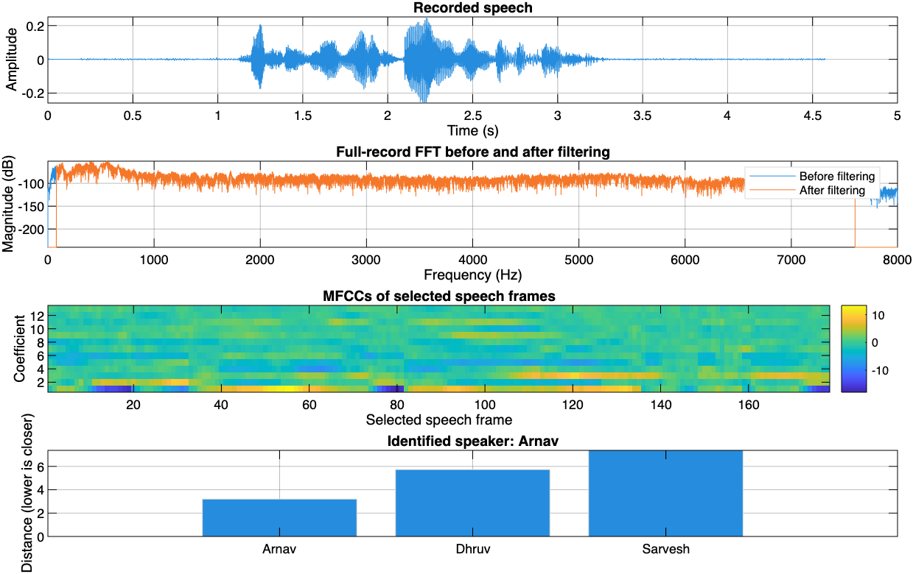
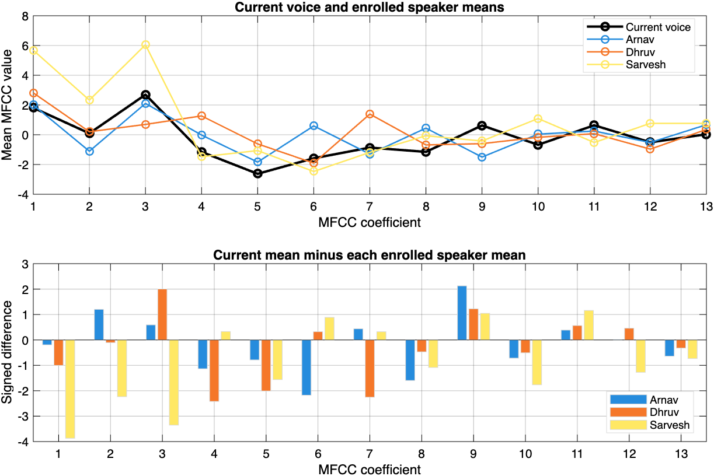

# Speaker Identification in MATLAB

Identify an enrolled speaker from a short recording of the same phrase. The project has **four MATLAB files**. Enrollment creates the shared audio-sample folders.

## How It Works

Profiles are calculated in memory from the WAV files every time you run identification. No metadata files or profile database are required. Names come from the speaker folder names.

## Files

| File | Purpose |
|---|---|
| `train_my_voice.m` | Record and save five samples for a named speaker |
| `run_demo.m` | Load speakers, identify new speech, and display results |
| `record_voice.m` | Shared microphone recording with quiet/speak cues |
| `sound_pattern.m` | Filter audio and extract MFCC and pitch features |

Enrollment creates `speaker_recordings/speaker_<name>/sample_001.wav` through `sample_005.wav`. The current enrollment set contains **two speakers and ten recordings**:

| Speaker | Recording folder | Samples |
|---|---|---|
| Arnav | `speaker_recordings/speaker_arnav/` | 5 |
| Sarvesh | `speaker_recordings/speaker_sarvesh/` | 5 |

These WAV files are included in the repository, so collaborators can pull the same enrollment set and test it with live speech.

## Use

Open the project folder in MATLAB. No additional toolboxes are required.

**To identify a speaker:** run `run_demo.m`, click **Record**, and speak into the microphone when prompted:

> This is my voice for identification.

The result appears in a dialog and the Command Window, with two separate figures shown as tabs in one MATLAB figure window:

- **Speaker identification:** the waveform, the full-record FFT before and after filtering, MFCCs, and matching distances. Lower distances indicate a closer match. Similar scores or a poor match to every profile produce **Uncertain match**, without assigning a speaker name.
- **Speaker mean comparison:** the current voice's mean MFCCs overlaid with each enrolled speaker's means, followed by the signed difference (current mean minus speaker mean) for each coefficient. Values closer to zero indicate similar means. These plots show arithmetic averages of the 13 mean features; identification combines robust median profiles of the 26 MFCC statistics with a voiced-pitch feature. Pitch is also printed in the Command Window.

Each successful run automatically saves `test_signal.png` and `test_comparison.png` beside the code, replacing the previous images. They are figure exports of the actual test input, with its prediction and comparisons. Commit and push these two files to share the latest test figures on GitHub.

### Latest Live Test

The saved figures below show an earlier user-performed live test against the Arnav and Sarvesh enrollments, before the pitch feature was added. They illustrate the plots and are not an accuracy benchmark. Each successful live run saves replacement figures locally.

With **one enrolled speaker**, the demo checks whether the live voice matches that enrollment. Both figures show only that speaker. This cannot establish identity against other people. When more people enroll, their bars, mean curves, difference bars, and legends are included automatically.

**To add a speaker:** run `train_my_voice.m`, enter their name, and record five examples. Stay quiet until **SPEAK NOW**, then finish the phrase within four seconds. Poor recordings are retried. Cancelling an unfinished enrollment keeps the existing recordings. Replacing an existing speaker folder requires confirmation.

Names are converted to lowercase folder names: `Arnav Deshpande` becomes `speaker_arnav_deshpande`. Spaces and punctuation become underscores, so use distinct names that produce different folders.

**To share recordings:** commit and push the person's entire speaker folder. Your collaborator pulls the changes and runs `run_demo.m`; the new speaker is included automatically. MATLAB does not push files to GitHub itself.

The live demo has no WAV-file selection option. Enrollment still saves 16 kHz WAV files for sharing. At least one enrolled speaker is needed. Use the same phrase and microphone setup for enrollment and testing, and have one person speak at a time.

## Signal Processing

1. Convert audio to mono, remove its mean, and retain 80–7600 Hz using an FFT mask and inverse FFT.
2. Select speech using frame power over 25 ms frames with a 10 ms hop.
3. Apply pre-emphasis, a Hamming window, a 512-point FFT, 26 mel filters, a logarithm, and a DCT.
4. Keep 13 MFCCs, excluding coefficient zero. Their means and standard deviations supply 26 spectral features. Also estimate vocal pitch from normalized autocorrelation of 40 ms speech frames, using lags corresponding to 70–400 Hz. At least 0.15 seconds of periodic voiced frames is required; the median pitch is stored as a base-2 logarithm, giving 27 features in total.
5. Take the coordinate-wise median of each person's five descriptors. Combine the scaled MFCC distance (75%) and log-pitch distance (25%), using robust within-speaker variation, then select the nearest profile only if the match passes the distance and separation checks. Inconsistent enrollment samples are reported in the Command Window.

The main Signals and Systems connections are discrete-time operations (Unit 1), LTI filtering and convolution (Unit 2), and Fourier analysis (Unit 4). The pre-emphasis difference equation also has a Z-transform interpretation (Unit 6):

$$
y[n]=x[n]-0.97x[n-1],\qquad H(z)=1-0.97z^{-1}.
$$

The finite-record Fourier operations use:

$$
X[k]=\sum_{n=0}^{N-1}x[n]e^{-j2\pi kn/N},\qquad Y[k]=H[k]X[k].
$$

Spectral multiplication corresponds to circular convolution at the DFT length. Pitch estimation adds a time-domain periodicity measurement:

$$
r_x[\ell]=\sum_n x[n]x[n+\ell],\qquad \hat f_0=\frac{f_s}{\ell_{\mathrm{peak}}}.
$$

The implementation normalizes each lag by the overlapping frame energies, accepts correlation peaks of at least 0.65, and chooses the earliest peak at least 90% as strong as the strongest peak. The median frequency over voiced frames reduces occasional pitch errors. This complements the vocal-tract information in MFCCs; pitch alone does not identify a speaker.

For MFCC statistics $\mathbf{m}=[\mu_1,\ldots,\mu_{13},\sigma_1,\ldots,\sigma_{13}]^T$ and $q=\log_2(\hat f_0)$, the matching score is:

$$
 d_s=\frac{0.75}{26}\sum_{i=1}^{26}\left(\frac{m_i-c_{s,i}}{a_i}\right)^2
 +0.25\left(\frac{q-c_{s,27}}{a_{27}}\right)^2.
$$

Here, $c_{s,i}$ is the coordinate-wise median enrollment descriptor. For residuals $e_{s,r,i}=p_{s,r,i}-c_{s,i}$, the shared scale is $a_i=\max(1.4826\operatorname{median}_{s,r}|e_{s,r,i}|,b_i)$, where $b_i=0.5$ for MFCC statistics and $b_{27}=0.1$ octave for log-pitch. This measures variation within speakers and reduces the influence of unusual enrollment clips. The feature weights and scale floors are practical choices for this small educational model.

With multiple speakers, a relative separation $(d_{(2)}-d_{(1)})/\max(d_{(2)},\varepsilon)$ below 0.20 produces an uncertain result. With any number of speakers, a best distance above 4 also produces an uncertain result. With one speaker, only the distance check is available. The distance limit corresponds to a weighted root-mean-square standardized mismatch above 2; these are practical heuristics, not confidence probabilities or validated unknown-speaker detection. Re-enroll when the Command Window flags inconsistent samples, and use fresh recordings to assess performance. MFCCs and classification extend the listed syllabus; Fourier-series and Laplace-transform calculations are not implemented.

This is an educational, closed-set speaker classifier. Human accuracy has not been established, and an unregistered person may be matched to an enrolled speaker. Use fresh test recordings rather than treating enrollment matches as accuracy measurements.
